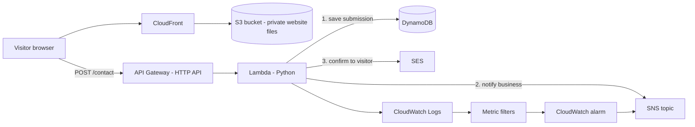

# TravelEase Serverless Contact Form (Rebuild)

A serverless contact form for a fictional travel company, built on AWS and managed entirely with Terraform. A visitor fills in a form on a static website. The message is validated, saved to a database, the business is notified, and the visitor gets a confirmation email. A GitHub Actions pipeline checks, plans and applies every infrastructure change.

This is the second iteration of the project, rebuilt from scratch over about 11 days. The first version, [travelease-contact](https://github.com/fatemehfeizipour/travelease-contact), was also built with Terraform and deployed from my laptop, with a few manual steps (uploading the website files). This version keeps Terraform and changes how the system is built, secured, deployed and monitored. What changed:

- a CI/CD pipeline checks, plans and applies every change, and logs in to AWS without stored access keys
- remote state in S3 with native locking, instead of state on one laptop
- the website sits behind CloudFront on a private S3 bucket instead of being served straight from S3, and the website files are uploaded by Terraform
- permissions are least privilege, with separate roles for planning and applying
- SNS notifies the business and SES emails the visitor, as two independent steps
- failures that the code catches and bot traffic are measured and alarmed with CloudWatch metric filters

**Region:** ca-central-1
**More detail on the infrastructure code:** see [infrastructure/README.md](infrastructure/README.md)

## Contents

1. [Architecture](#architecture)
2. [What happens when a visitor clicks Send](#what-happens-when-a-visitor-clicks-send)
3. [Screenshots](#screenshots)
4. [Design decisions](#design-decisions)
5. [Monitoring](#monitoring)
6. [SES sandbox](#ses-sandbox)
7. [Terraform](#terraform)
8. [CI/CD with GitHub Actions](#cicd-with-github-actions)
9. [How the project came together](#how-the-project-came-together)
10. [Problems I ran into and how I solved them](#problems-i-ran-into-and-how-i-solved-them)
11. [Known limitations](#known-limitations)
12. [Future plan](#future-plan)

## Architecture

[↑ Back to contents](#contents)

> **Screenshot placeholder:** a hand-drawn or draw.io version of this diagram, saved as `docs/screenshots/00-architecture.png`

## What happens when a visitor clicks Send

[↑ Back to contents](#contents)

1. The browser loads the page from CloudFront. The S3 bucket is private and only CloudFront can read it (origin access control).
2. JavaScript stops the normal form submit and calls `fetch()` with the form fields as JSON in a POST request. This only hands the request to the browser. The browser decides what actually goes out on the network.
3. The page comes from the CloudFront URL and the API lives on a different URL, so the browser treats them as two different origins. Because the request has a `Content-Type` of `application/json`, the browser holds the POST back and first sends a small preflight request (method `OPTIONS`) to API Gateway, asking whether this site is allowed to call the API. The browser does this by itself, not my JavaScript.
4. API Gateway (HTTP API) answers the preflight with CORS headers. These say which website is allowed (only the CloudFront URL), which methods are allowed (`POST`), and which request headers are allowed (`Content-Type`). If the website matches, the browser sends the real POST. If it does not match, the browser blocks the request and Lambda never runs.
5. API Gateway passes the real POST request to the Lambda function.
6. Lambda validates the input again on the server side. It does not trust the browser.
7. If the hidden honeypot field is filled in, Lambda returns a fake success and writes and sends nothing.
8. Lambda writes the submission to DynamoDB first. If that fails, nothing is sent and the visitor gets an error.
9. If the write works, SNS notifies the business and SES emails the visitor. These two are independent, so one failing does not block the other.
10. When the response comes back, JavaScript checks the status. For a 4xx it shows a message to fix the input, and for a 5xx it shows that something broke on our side.

## Screenshots

[↑ Back to contents](#contents)

Replace each placeholder with the real image (``) once the screenshot is saved in `docs/screenshots/`.

**The product**

> **Screenshot placeholder:** the contact form on the CloudFront URL (`01-website-form.png`)
>
> **Screenshot placeholder:** the success message after sending (`02-success-message.png`)
>
> **Screenshot placeholder:** the validation error shown for a bad input (`03-validation-error.png`)

**What the backend did with it**

> **Screenshot placeholder:** the new item in the DynamoDB table (`04-dynamodb-item.png`)
>
> **Screenshot placeholder:** the SNS notification email the business receives (`05-sns-email.png`)
>
> **Screenshot placeholder:** the SES confirmation email the visitor receives (`06-ses-email.png`)
>
> **Screenshot placeholder:** Lambda log events in CloudWatch Logs (`07-cloudwatch-logs.png`)

**Monitoring**

> **Screenshot placeholder:** the failure alarm email, from the SES sandbox test (`08-alarm-email.png`)
>
> **Screenshot placeholder:** the HoneypotTriggers metric after the bot-style test (`09-honeypot-metric.png`)

**Terraform and the pipeline**

> **Screenshot placeholder:** `terraform plan` and `apply` output (`10-terraform-apply.png`)
>
> **Screenshot placeholder:** the state bucket with versioning on (`11-state-bucket.png`)
>
> **Screenshot placeholder:** the three workflows, all green, in the Actions tab (`12-actions-green.png`)
>
> **Screenshot placeholder:** the plan output on a pull request (`13-plan-on-pr.png`)
>
> **Screenshot placeholder:** the apply workflow running after a merge (`14-apply-on-merge.png`)
>
> **Screenshot placeholder:** the trust policy of the apply role, limited to the main branch (`15-apply-role-trust.png`)

## Design decisions

[↑ Back to contents](#contents)

- **HTTP API instead of REST API.** Cheaper and simpler, and it is enough for one POST route.
- **DynamoDB on-demand capacity.** Traffic is low and unpredictable, so there is nothing to size. Each submission gets a unique ID as the partition key.
- **Private S3 bucket behind CloudFront.** All four block-public-access settings are on. The bucket policy only allows the one CloudFront distribution.
- **Least privilege for the Lambda role.** It can only write to its table, publish to its topic, send from its sender identity and write to its log group.
- **Honeypot field.** A field called `website` is hidden with CSS (not `type="hidden"`, which bots skip). Real visitors never fill it in. A metric filter counts how often it triggers.
- **Throttling on the API stage** (rate 5, burst 10) to cap the overall request rate. It is not the same as a WAF, which blocks specific bad clients.
- **Validation in both JavaScript and Lambda.** The JavaScript is for a good user experience. The Lambda check is the one that actually protects the system, because anyone can skip the browser and call the API directly.
- **CORS protects visitors' browsers, not the API.** It is a browser rule, enforced through the preflight request described above. A tool like curl ignores it, which is why throttling and validation exist.
- **SQS is left out on purpose.** At this volume the form does not need a queue. For traffic spikes, the next step would be a queue and a second Lambda for sending emails, with a dead-letter queue.

## Monitoring

[↑ Back to contents](#contents)

- Lambda logs go to CloudWatch Logs with a 3-day retention.
- A metric filter counts log lines containing "failed". An alarm on that metric notifies the SNS topic. This is needed because the code catches errors from SNS and SES and still returns success to the visitor, so Lambda's built-in error metric would not see them.
- A second metric filter counts honeypot triggers, to spot bot spikes.

## SES sandbox

[↑ Back to contents](#contents)

The project stays in the SES sandbox on purpose. Leaving the sandbox requires a verified domain, and I chose not to buy one for a learning project. In the sandbox, SES can only send to verified addresses, so a verified test recipient stands in for a customer. For real customers, the sandbox would have to be lifted (a domain with Route 53 and ACM is on the future plan below).

## Terraform

[↑ Back to contents](#contents)

All infrastructure is in the `infrastructure/` folder (see its own README for details).

- **Remote state** in a separate S3 bucket (versioned, public access blocked), with S3 native locking (`use_lockfile`). The state bucket was created by hand, because Terraform cannot create the place where its own state is stored.
- **Secrets stay out of git.** The notification email, SES sender and SES test recipient are variables, supplied locally through a git-ignored `terraform.tfvars` and in the pipeline through GitHub repository secrets.
- Line endings are fixed to LF with `.gitattributes`, and the Lambda zip uses a fixed file mode, so Windows and the Linux runner produce the same hashes and the plan shows no false changes.

To deploy it yourself, create `terraform.tfvars` with the three variables, then run `terraform init`, `terraform plan` and `terraform apply` from `infrastructure/`.

## CI/CD with GitHub Actions

[↑ Back to contents](#contents)

| Workflow | Trigger | What it does | Role |
|---|---|---|---|
| Terraform Check | every push | `fmt -check`, `init -backend=false`, `validate` | none |
| Terraform Plan | pull request | `init` and `plan`, so changes are read before merging | read-only role |
| Terraform Apply | push to `main` (a merge) | `init` and `apply -auto-approve` | separate write role |

- **No stored AWS keys.** GitHub proves its identity to AWS with OIDC and gets short-lived credentials. Each role's trust policy only accepts tokens from this repository, and the apply role only accepts tokens from the `main` branch.
- **Two roles on purpose.** A pull request runs the workflow file from the PR, so it must never hold write access.
- **Apply role permissions** are one inline policy per service (state bucket, DynamoDB, Lambda, SNS, SES, CloudWatch, S3, API Gateway, CloudFront, IAM), limited to this project's own resources. IAM is limited to roles and policies named `travelease-*`. A few list and describe actions cannot be limited to one resource, so they are allowed on all resources and are read-only.
- Changes to the apply role's own permissions are applied once from a laptop, because the role cannot grant itself permissions it does not yet have.
- The merge is the approval: nothing reaches AWS unless a pull request was opened, its plan was read, and it was merged.

## How the project came together

[↑ Back to contents](#contents)

About 11 days, built in this order:

1. **Design first.** Decided the pieces and why (S3, API Gateway, Lambda, DynamoDB, SNS, SES), and worked through the questions I was unsure about: SNS vs SES vs SQS, CORS vs curl, WAF vs throttling.
2. **Terraform foundation.** Provider, `init`, `plan`, `apply`, state, `.gitignore`, first commits.
3. **Data and permissions.** DynamoDB table, the Lambda role (trust policy vs permissions policy), SNS topic and subscription, SES identities, CloudWatch log group.
4. **Compute and API.** The Lambda function, tested in the console first, then the HTTP API (integration, route, stage, Lambda permission), tested with a real POST.
5. **The website.** Private S3 bucket, CloudFront with origin access control, bucket policy, CORS built from the CloudFront domain.
6. **Observability and protection.** Throttling, failure metric filter and alarm, honeypot metric filter.
7. **CI/CD.** Check workflow, OIDC provider and role, remote state in S3, plan on pull requests, then a separate role and workflow for apply.
8. **Documentation.** This README and the infrastructure README.

## Problems I ran into and how I solved them

[↑ Back to contents](#contents)

- **Pipeline plan wanted to recreate everything.** The GitHub runner had no state file, because state was local. I moved state to an S3 backend with native locking.
- **`AssumeRoleWithWebIdentity` not authorized.** The real OIDC subject includes the account and repository IDs, not just their names. I printed the token subject in a temporary debug step, found the real format, then fixed the trust policy condition and removed the debug step.
- **The read-only plan role could not take the state lock.** Locking writes a small file to S3. I added a narrow policy for just that one lock file.
- **False changes in the plan on the runner.** Windows line endings (CRLF) and the zip's file mode made hashes differ from Ubuntu's. Fixed with `.gitattributes` (LF) and a fixed file mode on the archive.
- **Renaming an IAM policy forced a replacement.** A policy's ARN contains its name, so a rename replaces the policy and its attachment. I read the plan first and understood why before applying.
- **First apply on `main` failed on access denied.** Some list and describe actions (CloudWatch Logs, SES) cannot be scoped to one resource. I added a small read-only policy for just those two actions.
- **A green check is not proof.** Check only means formatting and syntax passed. The plan on a pull request is what shows whether AWS matches the code.

## Known limitations

[↑ Back to contents](#contents)

- The apply role can attach policies to any `travelease-*` role, including itself. A condition on which policies it may attach would close that gap.
- No custom domain yet, so the SES sandbox stays on and the site uses the default CloudFront URL.
- No automated security scanning in the pipeline yet.
- A budget alert and a few small clean-ups are still planned.

## Future plan

[↑ Back to contents](#contents)

This project is the base for a larger roadmap. The next steps, grouped by theme:

**Security and quality in the pipeline**
- Add **Checkov** to the GitHub Actions workflow, so insecure Terraform is caught before the plan.
- Add **Cognito** for authentication and authorization.
- Move sensitive values to **Secrets Manager**.

**Domain and email**
- **Route 53** for a custom domain and **ACM** for the HTTPS certificate, which also lets me verify a domain and request SES production access.

**Developer experience**
- A script for local execution (plan, apply and checks in one command).
- **Ansible** for configuration tasks.

**A containerised version of the platform**
- **Docker** images, run on **ECS with Fargate** behind an **Application Load Balancer**, with a proper **VPC** (subnets, security groups) and a database on **RDS**.
- **EKS** as a comparison to ECS.

**Same stack, other tools**
- Rebuild the infrastructure in **CloudFormation** and **CDK** to compare with Terraform.

**Operations**
- Extend **CloudWatch** monitoring and logging to the new components (dashboards, alarms on the load balancer and containers).
