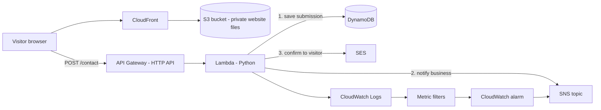

# TravelEase Serverless Contact Form (Rebuild)

A serverless contact form for a fictional travel company, built on AWS and managed entirely with Terraform. A visitor fills in a form on a static website. The message is validated, saved to a database, the business is notified, and the visitor gets a confirmation email. A GitHub Actions pipeline checks, plans and applies every infrastructure change.

This is the second version of the project. I rebuilt it from scratch to understand every piece well enough to explain it. The first attempt lives in its own repository, and the main differences are:

- everything is written as code with Terraform instead of being clicked together in the console
- the website sits behind CloudFront on a private S3 bucket instead of being served straight from S3
- there is a CI/CD pipeline that logs in to AWS without stored access keys
- failures and bot traffic are measured and alarmed

**Region:** ca-central-1

## Architecture

## What happens when a visitor clicks Send

1. The browser loads the page from CloudFront. The S3 bucket is private and only CloudFront can read it (origin access control).
2. JavaScript stops the normal form submit, sends the fields as a POST request to the API, and shows a different message for 4xx (fix your input) and 5xx (something broke on our side) responses.
3. API Gateway (HTTP API) passes the request to the Lambda function. CORS is set so that only the CloudFront site can call the API from a browser.
4. Lambda validates the input again on the server side. It does not trust the browser.
5. If the hidden honeypot field is filled in, Lambda returns a fake success and writes and sends nothing.
6. Lambda writes the submission to DynamoDB first. If that fails, nothing is sent and the visitor gets an error.
7. If the write works, SNS notifies the business and SES emails the visitor. These two are independent, so one failing does not block the other.

## Design decisions

- **HTTP API instead of REST API.** Cheaper and simpler, and it is enough for one POST route.
- **DynamoDB on-demand capacity.** Traffic is low and unpredictable, so there is nothing to size. Each submission gets a unique ID as the partition key.
- **Private S3 bucket behind CloudFront.** All four block-public-access settings are on. The bucket policy only allows the one CloudFront distribution.
- **Least privilege for the Lambda role.** It can only write to its table, publish to its topic, send from its sender identity and write to its log group.
- **Honeypot field.** A field called `website` is hidden with CSS (not `type="hidden"`, which bots skip). Real visitors never fill it in. A metric filter counts how often it triggers.
- **Throttling on the API stage** (rate 5, burst 10) to cap the overall request rate. It is not the same as a WAF, which blocks specific bad clients.
- **Validation in both JavaScript and Lambda.** The JavaScript is for a good user experience. The Lambda check is the one that actually protects the system, because anyone can skip the browser and call the API directly.
- **CORS protects visitors' browsers, not the API.** A tool like curl ignores it, which is why throttling and validation exist.
- **SQS is left out on purpose.** At this volume the form does not need a queue. For traffic spikes, the next step would be a queue and a second Lambda for sending emails, with a dead-letter queue.

## Monitoring

- Lambda logs go to CloudWatch Logs with a 3-day retention.
- A metric filter counts log lines containing "failed". An alarm on that metric notifies the SNS topic. This is needed because the code catches errors from SNS and SES and still returns success to the visitor, so Lambda's built-in error metric would not see them.
- A second metric filter counts honeypot triggers, to spot bot spikes.

## SES sandbox

The project stays in the SES sandbox on purpose. Leaving the sandbox requires a verified domain, and I chose not to buy one for a learning project. In the sandbox, SES can only send to verified addresses, so a verified test recipient stands in for a customer. For real customers, the sandbox would have to be lifted.

## Terraform

All infrastructure is in the `infrastructure/` folder.

- **Remote state** in a separate S3 bucket (versioned, public access blocked), with S3 native locking (`use_lockfile`). The state bucket was created by hand, because Terraform cannot create the place where its own state is stored.
- **Secrets stay out of git.** The notification email, SES sender and SES test recipient are variables, supplied locally through a git-ignored `terraform.tfvars` and in the pipeline through GitHub repository secrets.
- Line endings are fixed to LF with `.gitattributes`, and the Lambda zip uses a fixed file mode, so Windows and the Linux runner produce the same hashes and the plan shows no false changes.

To deploy it yourself, create `terraform.tfvars` with the three variables, then run `terraform init`, `terraform plan` and `terraform apply` from `infrastructure/`.

## CI/CD with GitHub Actions

| Workflow | Trigger | What it does | Role |
|---|---|---|---|
| Terraform Check | every push | `fmt -check`, `init -backend=false`, `validate` | none |
| Terraform Plan | pull request | `init` and `plan`, so changes are read before merging | read-only role |
| Terraform Apply | push to `main` (a merge) | `init` and `apply -auto-approve` | separate write role |

- **No stored AWS keys.** GitHub proves its identity to AWS with OIDC and gets short-lived credentials. Each role's trust policy only accepts tokens from this repository, and the apply role only accepts tokens from the `main` branch.
- **Two roles on purpose.** A pull request runs the workflow file from the PR, so it must never hold write access.
- **Apply role permissions** are one inline policy per service (state bucket, DynamoDB, Lambda, SNS, SES, CloudWatch, S3, API Gateway, CloudFront, IAM), limited to this project's own resources. IAM is limited to roles and policies named `travelease-*`. A few list and describe actions cannot be limited to one resource, so they are allowed on all resources and are read-only.
- Changes to the apply role's own permissions are applied once from a laptop, because the role cannot grant itself permissions it does not yet have.

## Known limitations and next steps

- The apply role can attach policies to any `travelease-*` role, including itself. A condition on which policies it may attach would close that gap.
- A budget alert and a few small clean-ups are still planned.
- Optional: SQS with a dead-letter queue for email retries during traffic spikes.
